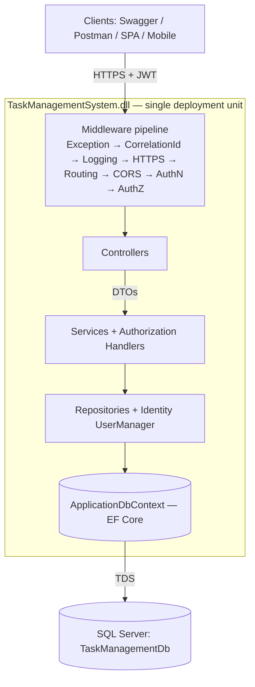
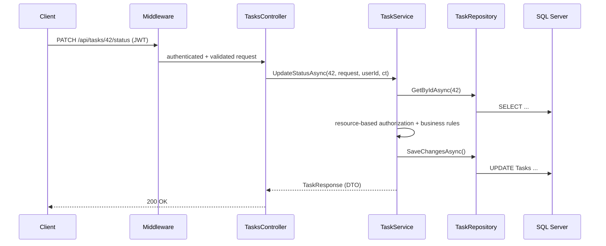
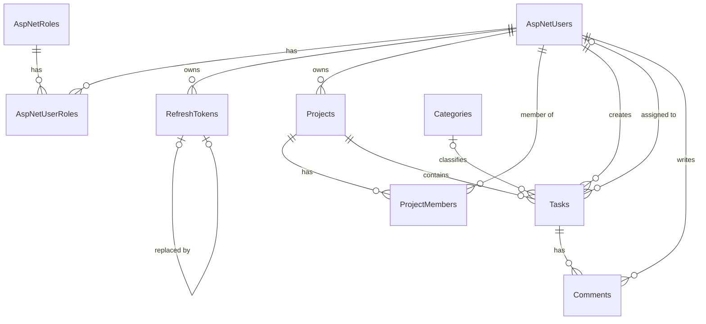

# 01 — Monolithic Architecture: Task Management System

A **Task Management System** built with **ASP.NET Core Web API (.NET 10)** as a **true monolith** — part of my personal *ASP.NET Core Architecture & Design Patterns Reference Library*.

Users register, log in, create projects, manage categories, create and assign tasks, track status, and comment — all served by **one** ASP.NET Core application deployed as **one unit**.

> 🚧 **Work in progress** — built phase by phase as a learning project. See [Progress](#progress). Each phase has a detailed write-up in [`docs/`](docs/).

---

## What is a Monolithic Architecture?

A monolith is an application whose modules (authentication, projects, tasks, comments, dashboard) live in **one codebase**, run in **one process**, are **deployed as one unit**, and share **one database**. Modules communicate through **in-process method calls**, not over the network.

Internally the code is organised in layers (Controllers → Services → Repositories → EF Core), but these are **folders/namespaces in a single project**, not separate deployables.

> This repository intentionally does **not** use Clean Architecture, Onion Architecture, Vertical Slice Architecture, or Microservices — those are covered in later repositories of this library.

## Architecture



### Request workflow (example: update a task's status)



Full explanation: [docs/01-Phase1-Architecture-and-Design.md](docs/01-Phase1-Architecture-and-Design.md)

## Features (planned)

- **Authentication** — registration, login, logout, email verification, forgot/reset/change password, JWT access tokens, refresh token rotation (ASP.NET Core Identity)
- **Authorization** — role-based (Admin, Manager, User), claims-based, policy-based and resource/ownership-based
- **Categories, Projects, Tasks, Comments** — full CRUD, task assignment, status workflow, priorities, due dates
- **Search, filtering, sorting, pagination** and **dashboard statistics**
- **FluentValidation**, global exception handling with **ProblemDetails**, **Serilog** structured logging with correlation IDs
- **Unit tests** (xUnit + Moq) and **integration tests** (WebApplicationFactory + test database)
- **Swagger / OpenAPI** documentation with JWT support

## Technology Stack

| Area | Technology |
|---|---|
| Runtime / Framework | .NET 10 (LTS), ASP.NET Core Web API (controllers) |
| Database | SQL Server, Entity Framework Core 10 (code-first migrations) |
| Identity | ASP.NET Core Identity, JWT Bearer, refresh tokens |
| Validation | FluentValidation |
| Logging | Serilog |
| API docs | OpenAPI (`Microsoft.AspNetCore.OpenApi`) + Swagger UI |
| Testing | xUnit, Moq, `WebApplicationFactory` |

## Project Structure

```
01-MonolithicArchitecture-TaskManagementSystem/
├── TaskManagementSystem.slnx
├── global.json                    # pins .NET 10 SDK
├── dotnet-tools.json              # dotnet-ef local tool
├── docs/                          # phase-by-phase design & learning notes
├── src/
│   └── TaskManagementSystem/      # THE monolith — one Web API project
│       ├── Controllers/  Models/{Entities,DTOs}/  Data/  Migrations/
│       ├── Interfaces/  Repositories/  Services/  Validators/
│       ├── Middleware/  Filters/  Authorization/  Exceptions/
│       ├── Extensions/  Configuration/  Mappings/
│       ├── Constants/  Enums/  Helpers/  wwwroot/
│       └── Program.cs
└── tests/
    ├── TaskManagementSystem.UnitTests/
    └── TaskManagementSystem.IntegrationTests/
```

Folders are added as each phase introduces them. Responsibilities of every folder: [Phase 1 doc §9](docs/01-Phase1-Architecture-and-Design.md#9-folder-structure).

## Database Design



Implemented with EF Core code-first (`InitialCreate` migration). Seed data: roles **Admin / Manager / User** and five default categories.

Keys, indexes, constraints and cascade-delete rules: [Phase 1 doc §8](docs/01-Phase1-Architecture-and-Design.md#8-database-design) (design) and [Phase 3 doc](docs/03-Phase3-Entities-and-Migrations.md) (implementation + verification).

## Getting Started

### Prerequisites
- [.NET 10 SDK](https://dotnet.microsoft.com/download/dotnet/10.0)
- SQL Server (local default instance or LocalDB)

### Setup
```powershell
git clone https://github.com/gauravrawatlabs/01-MonolithicArchitecture-TaskManagementSystem.git
cd 01-MonolithicArchitecture-TaskManagementSystem
dotnet tool restore                # installs dotnet-ef from dotnet-tools.json
dotnet build
```

### Secrets (User Secrets — never committed)
```powershell
# JWT signing key: at least 32 random characters
$b = New-Object byte[] 64; [Security.Cryptography.RandomNumberGenerator]::Fill($b)
dotnet user-secrets set "Jwt:SigningKey" ([Convert]::ToBase64String($b)) --project src/TaskManagementSystem

# First admin account, created automatically at startup
dotnet user-secrets set "SeedAdmin:Email" "admin@taskmanagement.local" --project src/TaskManagementSystem
dotnet user-secrets set "SeedAdmin:Password" "<strong password>" --project src/TaskManagementSystem
```

The development connection string is in `src/TaskManagementSystem/appsettings.Development.json` (Windows authentication, `Server=localhost`). Adjust it for your SQL Server instance, or override it with the `ConnectionStrings__DefaultConnection` environment variable.

### Database / migrations
```powershell
dotnet ef database update --project src/TaskManagementSystem                    # create/update the database
dotnet ef migrations add <MigrationName> --project src/TaskManagementSystem     # add a migration
```

### Run
```powershell
dotnet run --project src/TaskManagementSystem --launch-profile https
```
The browser opens **Swagger UI** automatically:

- Swagger UI (Development): `https://localhost:7188/swagger`  — explore and test every endpoint
- OpenAPI document (Development): `https://localhost:7188/openapi/v1.json`
- Health check: `https://localhost:7188/health`

## API Endpoints

| Method | Endpoint | Description | Auth |
|---|---|---|---|
| POST | `/api/auth/register` | Create an account (role `User`) | Anonymous |
| POST | `/api/auth/login` | Log in → access token (15 min) + refresh token (7 days) | Anonymous |
| POST | `/api/auth/refresh` | New token pair (rotation; reuse revokes all sessions) | Anonymous |
| POST | `/api/auth/logout` | Revoke this device's refresh token | Anonymous |
| POST | `/api/auth/logout-all` | Revoke all of the user's refresh tokens | 🔒 Bearer token |
| GET | `/api/auth/me` | Current user's profile | 🔒 Bearer token |
| POST | `/api/account/confirm-email` | Confirm email with the emailed token | Anonymous |
| POST | `/api/account/resend-confirmation` | Send a new confirmation email | Anonymous |
| POST | `/api/account/forgot-password` | Send a password-reset email | Anonymous |
| POST | `/api/account/reset-password` | Set a new password with the emailed token | Anonymous |
| POST | `/api/account/change-password` | Change password (ends all sessions) | 🔒 Bearer token |
| GET | `/api/categories` | List all categories (ordered by name) | 🔒 Any logged-in user |
| GET | `/api/categories/{id}` | Get a category; `404` ProblemDetails if missing | 🔒 Any logged-in user |
| POST | `/api/categories` | Create a category (`201` + `Location`; `409` if the name exists) | 🔒 Admin + verified email |
| PUT | `/api/categories/{id}` | Update a category | 🔒 Admin + verified email |
| DELETE | `/api/categories/{id}` | Delete a category (tasks keep existing, uncategorized) | 🔒 Admin + verified email |
| GET | `/api/projects` | Projects you own or belong to (Admin: all), search + paging | 🔒 Logged in |
| GET | `/api/projects/{id}` | Project with members | 🔒 Members, Admin |
| POST | `/api/projects` | Create a project (you become owner) | 🔒 Admin/Manager + verified email |
| PUT | `/api/projects/{id}` | Update a project | 🔒 Owner, Admin |
| DELETE | `/api/projects/{id}` | Delete a project (cascades tasks/comments) | 🔒 Owner, Admin |
| POST | `/api/projects/{id}/members` | Add a team member | 🔒 Owner, Admin |
| DELETE | `/api/projects/{id}/members/{userId}` | Remove a member (unassigns their tasks) | 🔒 Owner, Admin |
| GET | `/api/users` | Search / filter / page users | 🔒 Admin + verified email |
| GET | `/api/users/{id}` | A user's profile | 🔒 Self or Admin (resource-based) |
| PUT | `/api/users/me` | Update own profile | 🔒 Verified email |
| PUT | `/api/users/{id}/roles` | Replace a user's roles | 🔒 Admin + verified email |
| PATCH | `/api/users/{id}/status` | Activate / deactivate an account | 🔒 Admin + verified email |
| GET | `/health` | Database connectivity check | Public |

**Testing protected endpoints in Swagger:** call `POST /api/auth/login`, copy `accessToken`, click **Authorize**, paste it.

**Emails in development** (confirmation, password reset) are written as `.html` files to `src/TaskManagementSystem/emails/` (gitignored) — open them in a browser; each shows the JSON to paste into Swagger.

All errors use the standard [ProblemDetails](https://www.rfc-editor.org/rfc/rfc9457) JSON format (validation errors include an `errors` object per field). More endpoints are added phase by phase.

### Test
```powershell
dotnet test
```

## Advantages and Disadvantages of a Monolith

| ✅ Advantages | ❌ Disadvantages |
|---|---|
| Simple to develop, run and debug | Risk of a "big ball of mud" as it grows |
| One build, one deployment pipeline | Any change redeploys the whole app |
| Easy ACID transactions (one database) | Scales only as a whole |
| Fast in-process calls, no network latency | Single technology stack |
| Straightforward end-to-end testing | One fault can take down the whole app |

**Use it for** new products/MVPs, small-to-medium teams and evolving domains. **Avoid it when** many independent teams need separate release cycles or modules have very different scaling needs — consider a modular monolith first.

## Progress

| Phase | Topic | Status |
|---|---|---|
| 1 | Requirements, architecture, ER design, folder structure | ✅ Done |
| 2 | Project setup, SQL Server & EF Core configuration | ✅ Done |
| 3 | Entities, DbContext, relationships, migrations, seed data | ✅ Done |
| 4 | Repository & service layers, exception handling, Swagger UI | ✅ Done |
| 5 | Identity + JWT authentication | ✅ Done |
| 6 | Refresh tokens, email verification, password flows | ✅ Done |
| 7 | Roles, claims, policies, resource-based authorization, user management | ✅ Done |
| 8 | Category CRUD API | ✅ Done |
| 9 | Project API + team members | ✅ Done |
| 10 | Task & Comment APIs | ⏳ |
| 11 | Validation, middleware, exception handling, logging | ⏳ |
| 12 | Search, filtering, sorting, pagination, dashboard | ⏳ |
| 13 | Unit & integration tests | ⏳ |
| 14 | Swagger / OpenAPI documentation | ⏳ |
| 15 | Final README & GitHub polish | ⏳ |

Detailed tracker: [docs/00-Progress-Tracker.md](docs/00-Progress-Tracker.md)

## Documentation

| Doc | Content |
|---|---|
| [01 — Architecture & Design](docs/01-Phase1-Architecture-and-Design.md) | Monolith concepts, diagrams, modules, permissions, ER design, folder structure |
| [02 — Project Setup](docs/02-Phase2-Project-Setup.md) | Solution setup, EF Core + SQL Server, DbContext lifetime, configuration |
| [03 — Entities & Migrations](docs/03-Phase3-Entities-and-Migrations.md) | Entities, Fluent API, relationships, delete behaviors, indexes, seeding, migrations |
| [04 — Repository & Service Layers](docs/04-Phase4-Repository-Service-Layers.md) | Layers, DI lifetimes, exceptions → ProblemDetails, Swagger UI |
| [05 — Identity & JWT](docs/05-Phase5-Identity-and-JWT.md) | Identity, password hashing, JWT structure & validation, User Secrets, FluentValidation |
| [06 — Refresh Tokens & Account Flows](docs/06-Phase6-Refresh-Tokens-and-Account-Flows.md) | Rotation, reuse detection, logout with JWT, email verification, password reset/change |
| [07 — Authorization](docs/07-Phase7-Authorization.md) | Fallback policy, role/claims/policy/resource-based authorization, user management |
| [08 — Category CRUD](docs/08-Phase8-Category-CRUD.md) | Composite policies, REST status codes, validation layers, race-safe uniqueness |
| [09 — Projects](docs/09-Phase9-Projects.md) | Owner/member authorization, 404 vs 403, row-level visibility, team management |

Testing details and interview questions will be added here as the corresponding phases are completed.
