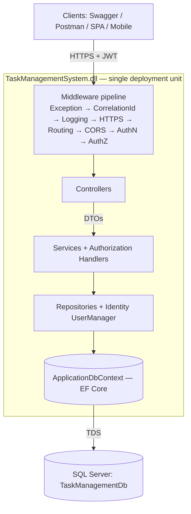
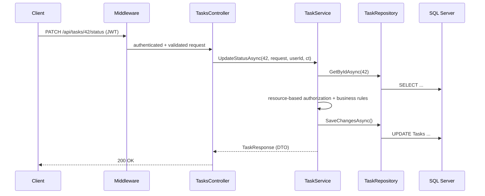

# 01 — Monolithic Architecture: Task Management System

A **Task Management System** built with **ASP.NET Core Web API (.NET 10)** as a **true monolith** — part of my personal *ASP.NET Core Architecture & Design Patterns Reference Library*.

Users register, log in, create projects, manage categories, create and assign tasks, track status, and comment — all served by **one** ASP.NET Core application deployed as **one unit**.

> 🚧 **Work in progress** — built phase by phase as a learning project. See [Progress](#progress). Each phase has a detailed write-up in [`docs/`](docs/).

---

## What is a Monolithic Architecture?

A monolith is an application whose modules (authentication, projects, tasks, comments, dashboard) live in **one codebase**, run in **one process**, are **deployed as one unit**, and share **one database**. Modules communicate through **in-process method calls**, not over the network.

Internally the code is organised in layers (Controllers → Services → Repositories → EF Core), but these are **folders/namespaces in a single project**, not separate deployables.

> This repository intentionally does **not** use Clean Architecture, Onion Architecture, Vertical Slice Architecture, or Microservices — those are covered in later repositories of this library.

## Architecture



### Request workflow (example: update a task's status)



Full explanation: [docs/01-Phase1-Architecture-and-Design.md](docs/01-Phase1-Architecture-and-Design.md)

## Features (planned)

- **Authentication** — registration, login, logout, email verification, forgot/reset/change password, JWT access tokens, refresh token rotation (ASP.NET Core Identity)
- **Authorization** — role-based (Admin, Manager, User), claims-based, policy-based and resource/ownership-based
- **Categories, Projects, Tasks, Comments** — full CRUD, task assignment, status workflow, priorities, due dates
- **Search, filtering, sorting, pagination** and **dashboard statistics**
- **FluentValidation**, global exception handling with **ProblemDetails**, **Serilog** structured logging with correlation IDs
- **Unit tests** (xUnit + Moq) and **integration tests** (WebApplicationFactory + test database)
- **Swagger / OpenAPI** documentation with JWT support

## Technology Stack

| Area | Technology |
|---|---|
| Runtime / Framework | .NET 10 (LTS), ASP.NET Core Web API (controllers) |
| Database | SQL Server, Entity Framework Core 10 (code-first migrations) |
| Identity | ASP.NET Core Identity, JWT Bearer, refresh tokens |
| Validation | FluentValidation |
| Logging | Serilog |
| API docs | OpenAPI (`Microsoft.AspNetCore.OpenApi`) + Swagger UI |
| Testing | xUnit, Moq, `WebApplicationFactory` |

## Project Structure

```
01-MonolithicArchitecture-TaskManagementSystem/
├── TaskManagementSystem.slnx
├── global.json                    # pins .NET 10 SDK
├── dotnet-tools.json              # dotnet-ef local tool
├── docs/                          # phase-by-phase design & learning notes
├── src/
│   └── TaskManagementSystem/      # THE monolith — one Web API project
│       ├── Controllers/  Models/{Entities,DTOs}/  Data/  Migrations/
│       ├── Interfaces/  Repositories/  Services/  Validators/
│       ├── Middleware/  Filters/  Authorization/  Exceptions/
│       ├── Extensions/  Configuration/  Mappings/
│       ├── Constants/  Enums/  Helpers/  wwwroot/
│       └── Program.cs
└── tests/
    ├── TaskManagementSystem.UnitTests/
    └── TaskManagementSystem.IntegrationTests/
```

Folders are added as each phase introduces them. Responsibilities of every folder: [Phase 1 doc §9](docs/01-Phase1-Architecture-and-Design.md#9-folder-structure).

## Database Design

```mermaid
erDiagram
    AspNetUsers ||--o{ AspNetUserRoles : has
    AspNetRoles ||--o{ AspNetUserRoles : has
    AspNetUsers ||--o{ RefreshTokens : owns
    RefreshTokens |o--o| RefreshTokens : "replaced by"
    AspNetUsers ||--o{ Projects : owns
    Projects ||--o{ ProjectMembers : has
    AspNetUsers ||--o{ ProjectMembers : "member of"
    Projects ||--o{ Tasks : contains
    Categories |o--o{ Tasks : classifies
    AspNetUsers ||--o{ Tasks : creates
    AspNetUsers |o--o{ Tasks : "assigned to"
    Tasks ||--o{ Comments : has
    AspNetUsers ||--o{ Comments : writes
```



Implemented with EF Core code-first (`InitialCreate` migration). Seed data: roles **Admin / Manager / User** and five default categories.

Keys, indexes, constraints and cascade-delete rules: [Phase 1 doc §8](docs/01-Phase1-Architecture-and-Design.md#8-database-design) (design) and [Phase 3 doc](docs/03-Phase3-Entities-and-Migrations.md) (implementation + verification).

## Getting Started

### Prerequisites
- [.NET 10 SDK](https://dotnet.microsoft.com/download/dotnet/10.0)
- SQL Server (local default instance or LocalDB)

### Setup
```powershell
git clone https://github.com/gauravrawatlabs/01-MonolithicArchitecture-TaskManagementSystem.git
cd 01-MonolithicArchitecture-TaskManagementSystem
dotnet tool restore                # installs dotnet-ef from dotnet-tools.json
dotnet build
```

The development connection string is in `src/TaskManagementSystem/appsettings.Development.json` (Windows authentication, `Server=localhost`). Adjust it for your SQL Server instance, or override it with the `ConnectionStrings__DefaultConnection` environment variable.

### Database / migrations
```powershell
dotnet ef database update --project src/TaskManagementSystem                    # create/update the database
dotnet ef migrations add <MigrationName> --project src/TaskManagementSystem     # add a migration
```

### Run
```powershell
dotnet run --project src/TaskManagementSystem --launch-profile https
```
- Health check: `https://localhost:7188/health`
- OpenAPI document (Development): `https://localhost:7188/openapi/v1.json`

### Test
```powershell
dotnet test
```

## Advantages and Disadvantages of a Monolith

| ✅ Advantages | ❌ Disadvantages |
|---|---|
| Simple to develop, run and debug | Risk of a "big ball of mud" as it grows |
| One build, one deployment pipeline | Any change redeploys the whole app |
| Easy ACID transactions (one database) | Scales only as a whole |
| Fast in-process calls, no network latency | Single technology stack |
| Straightforward end-to-end testing | One fault can take down the whole app |

**Use it for** new products/MVPs, small-to-medium teams and evolving domains. **Avoid it when** many independent teams need separate release cycles or modules have very different scaling needs — consider a modular monolith first.

## Progress

| Phase | Topic | Status |
|---|---|---|
| 1 | Requirements, architecture, ER design, folder structure | ✅ Done |
| 2 | Project setup, SQL Server & EF Core configuration | ✅ Done |
| 3 | Entities, DbContext, relationships, migrations, seed data | ✅ Done |
| 4 | Repository & service layers | ⏳ |
| 5 | Identity + JWT authentication | ⏳ |
| 6 | Refresh tokens, email verification, password flows | ⏳ |
| 7 | Roles, claims, policies, resource-based authorization | ⏳ |
| 8–10 | Category, Project, Task & Comment APIs | ⏳ |
| 11 | Validation, middleware, exception handling, logging | ⏳ |
| 12 | Search, filtering, sorting, pagination, dashboard | ⏳ |
| 13 | Unit & integration tests | ⏳ |
| 14 | Swagger / OpenAPI documentation | ⏳ |
| 15 | Final README & GitHub polish | ⏳ |

Detailed tracker: [docs/00-Progress-Tracker.md](docs/00-Progress-Tracker.md)

## Documentation

| Doc | Content |
|---|---|
| [01 — Architecture & Design](docs/01-Phase1-Architecture-and-Design.md) | Monolith concepts, diagrams, modules, permissions, ER design, folder structure |
| [02 — Project Setup](docs/02-Phase2-Project-Setup.md) | Solution setup, EF Core + SQL Server, DbContext lifetime, configuration |
| [03 — Entities & Migrations](docs/03-Phase3-Entities-and-Migrations.md) | Entities, Fluent API, relationships, delete behaviors, indexes, seeding, migrations |

API endpoints, testing details and interview questions will be added here as the corresponding phases are completed.
