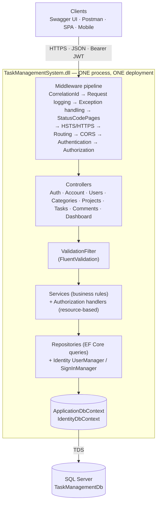
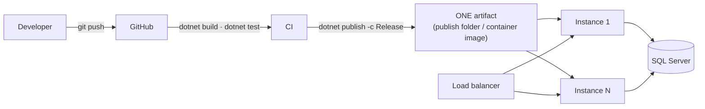
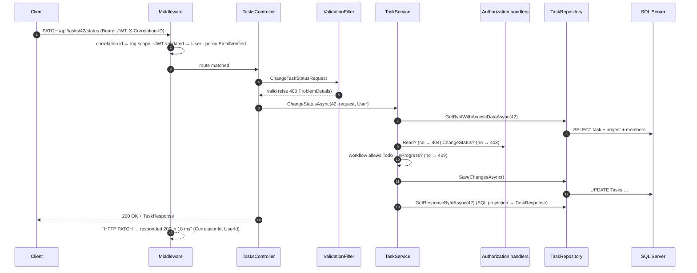
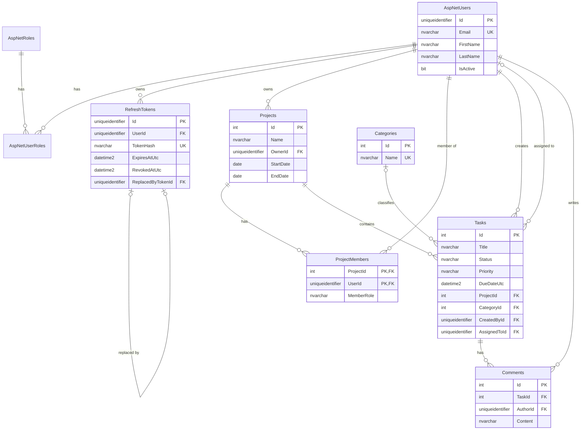

# 01 — Monolithic Architecture: Task Management System

A production-conscious **Task Management System** built with **ASP.NET Core Web API (.NET 10)** as a **true monolith** — the first project of my *ASP.NET Core Architecture & Design Patterns Reference Library*.

Users register and verify their email, log in with JWT + rotating refresh tokens, create projects and teams, manage categories, create and assign tasks, move them through a status workflow, comment, and see a dashboard — all served by **one** application, deployed as **one unit**, backed by **one** SQL Server database.

| | |
|---|---|
| **Architecture** | Layered monolith (Controllers → Services → Repositories → EF Core) in a single Web API project |
| **API** | 40 REST operations, OpenAPI 3.1 + Swagger UI, RFC 9457 ProblemDetails errors |
| **Security** | ASP.NET Core Identity, JWT (15 min) + refresh-token rotation with reuse detection, role / claims / policy / resource-based authorization, secure by default |
| **Quality** | 151 unit + 37 integration tests (all passing), 86.9 % line coverage, 0 build warnings |
| **Docs** | 15 phase-by-phase learning documents in [`docs/`](docs/) |

---

## Table of Contents
1. [What is a Monolithic Architecture?](#what-is-a-monolithic-architecture)
2. [Architecture](#architecture)
3. [Request Workflow](#request-workflow)
4. [Features](#features)
5. [Technology Stack](#technology-stack)
6. [Project Structure](#project-structure)
7. [Database Design](#database-design)
8. [Security Model](#security-model)
9. [Getting Started](#getting-started)
10. [Configuration](#configuration)
11. [Database Migrations](#database-migrations)
12. [API Endpoints](#api-endpoints)
13. [Errors & Logging](#errors--logging)
14. [Testing](#testing)
15. [Deployment Notes](#deployment-notes)
16. [Advantages and Disadvantages](#advantages-and-disadvantages)
17. [Interview Questions](#interview-questions)
18. [Roadmap](#roadmap)
19. [Documentation (Learning Notes)](#documentation-learning-notes)

---

## What is a Monolithic Architecture?

A **monolith** is an application whose modules — here authentication, users, categories, projects, tasks, comments and the dashboard — live in **one codebase**, run in **one process**, are **deployed as one unit** and share **one database**.

- Modules talk to each other through **in-process method calls** (e.g. `TaskService` uses `IProjectRepository` and `UserManager` directly) — no HTTP between modules, no distributed failures, simple ACID transactions.
- Internally the code is still organized into **layers** (folders/namespaces in one project): Controllers → Services → Repositories → EF Core.
- This is a **layered (N-tier) monolith**, deliberately **not** Clean Architecture, Onion, Vertical Slice or Microservices — those are covered in later repositories of this library. Dependencies flow top-down; entities are EF Core entities; everything compiles into one assembly, `TaskManagementSystem.dll`.

## Architecture



| Layer | Responsibility | Never contains |
|---|---|---|
| **Middleware** | Cross-cutting: correlation IDs, logging, errors → ProblemDetails, HTTPS, CORS, authentication, authorization | Business rules |
| **Controllers** | HTTP adapter: routes, binding, status codes, `[Authorize]` policies | Logic, EF Core |
| **Validators** | Input rules (FluentValidation), run automatically by `ValidationFilter` | Database lookups |
| **Services** | Business rules, workflows, resource-based authorization, Entity → DTO | HTTP concepts |
| **Repositories** | Data access: LINQ queries, projections, row-level visibility filters | Business rules |
| **Data** | `ApplicationDbContext`, Fluent API configurations, migrations, seeding | — |


Scaling: run N identical copies behind a load balancer. JWT validation is stateless; refresh tokens live in the shared database.

## Request Workflow



## Features

| Module | Capabilities |
|---|---|
| **Authentication** | Register (role `User`), login, JWT access tokens (15 min), refresh tokens (7 days, hashed, **rotation + reuse detection**), logout (device / all devices), current user |
| **Account** | Email verification, resend confirmation, forgot / reset / change password (sessions revoked after password changes), no account enumeration |
| **Users** | Own profile; Admin: search/filter/sort/page users, change roles, activate/deactivate (revokes sessions) |
| **Categories** | CRUD; read for everyone, write for Admins with verified email; case-insensitive unique names, race-safe |
| **Projects** | CRUD, team members, owner/member/admin rules, per-owner unique names, removing a member unassigns their tasks |
| **Tasks** | CRUD, priorities, due dates (future, within project end), categories, assignment to active members, **status workflow** (Todo ⇄ InProgress ⇄ InReview → Done, Cancelled; reopen = owner/Admin) |
| **Comments** | Members comment; author edits; author / project owner / Admin delete |
| **Search & lists** | Filters (status, priority, category, assignee, due range, overdue, owned by me…), whitelisted `sortBy`/`sortDirection`, stable paging (max 100) |
| **Dashboard** | Totals, open, overdue, due in 7 days, completed in 7 days, my work, by status/priority, project progress — computed with SQL aggregates, scoped to what the caller may see |
| **Cross-cutting** | FluentValidation, ProblemDetails errors, Serilog structured logs, correlation IDs, CORS, HSTS, health check, Swagger UI with examples |

## Technology Stack

| Area | Technology |
|---|---|
| Runtime / framework | .NET 10 (LTS), ASP.NET Core Web API (controllers), C# 14 |
| Database / ORM | SQL Server, Entity Framework Core 10.0.15 (code-first migrations) |
| Identity & security | ASP.NET Core Identity, JWT Bearer 10.0.15, refresh tokens (SHA-256 hashed) |
| Validation | FluentValidation 12.2.0 |
| Logging | Serilog.AspNetCore 10.0.0 (console text / JSON) |
| API documentation | Microsoft.AspNetCore.OpenApi 10.0.15 (OpenAPI 3.1) + Swashbuckle.AspNetCore.SwaggerUI 10.3.1 |
| Testing | xUnit 2.9, Moq 4.21, Microsoft.Extensions.TimeProvider.Testing, Microsoft.AspNetCore.Mvc.Testing (`WebApplicationFactory`), coverlet + ReportGenerator |
| Tooling | `global.json` (SDK 10.0.x), local tools `dotnet-ef`, `reportgenerator` |

## Project Structure

```
01-MonolithicArchitecture-TaskManagementSystem/
├── TaskManagementSystem.slnx              solution (new XML format)
├── global.json                            pins the .NET 10 SDK
├── dotnet-tools.json                      local tools: dotnet-ef, reportgenerator
├── coverlet.runsettings                   coverage scope (app code, no migrations)
├── docs/                                  15 phase-by-phase learning documents
├── src/TaskManagementSystem/              THE monolith — one Web API project
│   ├── Controllers/        HTTP endpoints only (8 controllers)
│   ├── Models/
│   │   ├── Entities/       EF Core entities: ApplicationUser, Project, ProjectMember, TaskItem, Comment, Category, RefreshToken
│   │   └── DTOs/           request/response contracts per module + Common (PagedResult, PagedQueryParameters)
│   ├── Data/               ApplicationDbContext, Configurations/ (Fluent API), Converters/, Seed/
│   ├── Migrations/         EF Core code-first migrations
│   ├── Interfaces/         Repositories/ and Services/ abstractions
│   ├── Repositories/       EF Core data access + QueryFilters (row-level visibility)
│   ├── Services/           business logic, TokenService, TaskStatusWorkflow, email senders
│   ├── Validators/         FluentValidation validators (+ shared paging validator)
│   ├── Authorization/      operations, resource-based handlers, policy building blocks
│   ├── Middleware/         CorrelationIdMiddleware, ExceptionHandlingMiddleware
│   ├── Filters/            ValidationFilter
│   ├── Exceptions/         NotFound / Conflict / Forbidden / BusinessRule / Unauthorized / RequestValidation
│   ├── Extensions/         DI registration, logging, OpenAPI, claims, HTTP helpers
│   ├── Configuration/      strongly-typed options (Jwt, Email, Cors, AdminSeed, ApiDocumentation)
│   ├── Mappings/           manual Entity → DTO mapping
│   ├── Constants/ Enums/ Helpers/
│   ├── appsettings.json · appsettings.Development.json   (no secrets)
│   └── Program.cs          composition root: services + middleware pipeline
└── tests/
    ├── TaskManagementSystem.UnitTests/         151 tests: workflow, handlers, validators, services
    └── TaskManagementSystem.IntegrationTests/   37 tests: real HTTP pipeline + test SQL Server database
```
Every folder's responsibility is explained in [docs/01 §9](docs/01-Phase1-Architecture-and-Design.md#9-folder-structure).

## Database Design



| Relationship | Type | On delete |
|---|---|---|
| RefreshToken → replacing RefreshToken | **1 : 1** (self, unique filtered index) | No action |
| User → RefreshTokens | 1 : N | Cascade |
| Project → Tasks → Comments | 1 : N | Cascade |
| Category → Tasks | 1 : N (optional) | Set null |
| User → owned Projects / created & assigned Tasks / Comments | 1 : N | Restrict (users are deactivated, never deleted) |
| Users ↔ Projects via **ProjectMembers** | **M : N** (explicit join entity with `MemberRole`) | Project side cascade |
| Users ↔ Roles via AspNetUserRoles | M : N (Identity) | Cascade |

Indexes cover every filter and sort path (e.g. `IX_Tasks_ProjectId_Status`, `IX_Tasks_AssignedToId_Status`, `IX_Comments_TaskId_CreatedAtUtc`); CHECK constraints guard enum values and `EndDate >= StartDate`. Details: [docs/03](docs/03-Phase3-Entities-and-Migrations.md).

## Security Model

**Authentication** — Identity hashes passwords (PBKDF2, 100 000 iterations, salted). Login returns a short-lived **JWT** (signature, issuer, audience, lifetime and algorithm validated) and an opaque **refresh token** stored only as a SHA-256 hash. Every refresh **rotates** the token; presenting an already-rotated token revokes **all** sessions (theft detection), race-safe via a conditional `UPDATE`. Lockout after 5 failed logins. Identical error messages prevent account enumeration.

**Authorization** — secure by default (fallback policy: every endpoint requires login unless `[AllowAnonymous]`):

| Style | Example |
|---|---|
| Role-based | `AdminOnly` → Admin user management |
| Claims-based | `EmailVerified` → `email_verified` claim required for all writes |
| Policy-based | `CanManageCategories` = Admin ∧ verified · `CanCreateProjects` = (Admin ∨ Manager) ∧ verified |
| Resource-based | `ProjectAuthorizationHandler`, `TaskAuthorizationHandler`, `CommentAuthorizationHandler`, `UserAuthorizationHandler` |

| Task action | Admin | Project owner | Creator | Assignee | Member | Outsider |
|---|---|---|---|---|---|---|
| Read / comment | ✅ | ✅ | ✅ | ✅ | ✅ | 404 |
| Update / delete | ✅ | ✅ | ✅ | ❌ 403 | ❌ 403 | 404 |
| Assign | ✅ | ✅ | ❌ | ❌ | ❌ | 404 |
| Change status | ✅ | ✅ | ✅ | ✅ | ❌ | 404 |
| Reopen Done / restore Cancelled | ✅ | ✅ | ❌ | ❌ | ❌ | 404 |

Outsiders get **404** (not 403) for resources with guessable integer ids, so existence isn't leaked.

## Getting Started

### Prerequisites
- [.NET 10 SDK](https://dotnet.microsoft.com/download/dotnet/10.0) (`global.json` pins 10.0.x)
- SQL Server (default instance `localhost` or LocalDB) with Windows authentication

### 1. Clone and restore
```powershell
git clone https://github.com/gauravrawatlabs/01-MonolithicArchitecture-TaskManagementSystem.git
cd 01-MonolithicArchitecture-TaskManagementSystem
dotnet tool restore        # dotnet-ef, reportgenerator
dotnet build
```

### 2. Secrets (User Secrets — never committed)
```powershell
# JWT signing key: at least 32 random characters (works in Windows PowerShell 5.1 and PowerShell 7)
$b = New-Object byte[] 64; [Security.Cryptography.RandomNumberGenerator]::Create().GetBytes($b)
dotnet user-secrets set "Jwt:SigningKey" ([Convert]::ToBase64String($b)) --project src/TaskManagementSystem

# First admin account, created automatically at startup
dotnet user-secrets set "SeedAdmin:Email" "admin@taskmanagement.local" --project src/TaskManagementSystem
dotnet user-secrets set "SeedAdmin:Password" "<strong password>" --project src/TaskManagementSystem
```

### 3. Database
The development connection string (`src/TaskManagementSystem/appsettings.Development.json`) points to `Server=localhost;Database=TaskManagementDb` with Windows authentication — adjust it for your SQL Server, or set `ConnectionStrings__DefaultConnection`.
```powershell
dotnet ef database update --project src/TaskManagementSystem   # creates tables + seeds roles and categories
```

### 4. Run
```powershell
dotnet run --project src/TaskManagementSystem --launch-profile https
```
The browser opens **Swagger UI** at `https://localhost:7188/swagger`:
1. `POST /api/auth/register` (body pre-filled) → `POST /api/auth/login` → copy `accessToken`.
2. **Authorize** → paste the token → call any 🔒 endpoint.
3. Confirmation and password-reset emails are written to `src/TaskManagementSystem/emails/*.html` (gitignored) — open one; it shows the JSON to paste into `POST /api/account/confirm-email`.
4. Log in as the seeded admin to promote yourself to **Manager** (`PUT /api/users/{id}/roles`) and create projects.

Also: OpenAPI document `https://localhost:7188/openapi/v1.json` · health check `https://localhost:7188/health`.

## Configuration

| Section | Keys | Where |
|---|---|---|
| `ConnectionStrings` | `DefaultConnection` | Development file / env `ConnectionStrings__DefaultConnection` |
| `Jwt` | `Issuer`, `Audience`, `AccessTokenLifetimeMinutes`, `RefreshTokenLifetimeDays`, **`SigningKey`** (secret) | appsettings + User Secrets / env `Jwt__SigningKey` |
| `SeedAdmin` | **`Email`, `Password`** (secrets) | User Secrets / env |
| `Email` | `FromAddress`, `PickupDirectory`, `ClientAppBaseUrl` | appsettings |
| `Cors` | `AllowedOrigins` | appsettings |
| `ApiDocumentation` | `Enabled` (Development: true) | appsettings / env |
| `Serilog` | `MinimumLevel` + overrides | appsettings |

Startup fails fast on a missing connection string or an invalid/short JWT key (options validated on start).

## Database Migrations

```powershell
dotnet ef migrations add <Name> --project src/TaskManagementSystem --output-dir Migrations   # new migration
dotnet ef migrations script --project src/TaskManagementSystem --idempotent -o migration.sql # review SQL / production
dotnet ef database update --project src/TaskManagementSystem                                 # apply
dotnet ef migrations has-pending-model-changes --project src/TaskManagementSystem            # CI check
dotnet ef migrations remove --project src/TaskManagementSystem                               # undo last (unapplied) migration
```

## API Endpoints

All list endpoints support `page` / `pageSize` (≤ 100) and return `items, page, pageSize, totalCount, totalPages, hasPreviousPage, hasNextPage`. 🔓 = anonymous, 🔒 = Bearer token.

| Method | Endpoint | Description | Access |
|---|---|---|---|
| POST | `/api/auth/register` | Create account (role User) + confirmation email | 🔓 |
| POST | `/api/auth/login` | Access token (15 min) + refresh token (7 days) | 🔓 |
| POST | `/api/auth/refresh` | Rotate tokens (reuse → all sessions revoked) | 🔓 |
| POST | `/api/auth/logout` | Revoke this refresh token | 🔓 |
| POST | `/api/auth/logout-all` | Revoke all refresh tokens | 🔒 |
| GET | `/api/auth/me` | Current user | 🔒 |
| POST | `/api/account/confirm-email` | Confirm email with emailed token | 🔓 |
| POST | `/api/account/resend-confirmation` | Send a new confirmation email | 🔓 |
| POST | `/api/account/forgot-password` | Send a password-reset email | 🔓 |
| POST | `/api/account/reset-password` | Set a new password with emailed token | 🔓 |
| POST | `/api/account/change-password` | Change password (ends all sessions) | 🔒 |
| GET | `/api/users` | Search / filter / sort / page users | 🔒 Admin |
| GET | `/api/users/lookup` | Find active users by name/email (max 20, for member pickers) | 🔒 Admin or Manager |
| GET | `/api/users/{id}` | A user's profile | 🔒 Self or Admin |
| PUT | `/api/users/me` | Update own profile | 🔒 Verified |
| PUT | `/api/users/{id}/roles` | Replace roles | 🔒 Admin |
| PATCH | `/api/users/{id}/status` | Activate / deactivate | 🔒 Admin |
| GET | `/api/categories` | List categories | 🔒 |
| GET | `/api/categories/{id}` | Get a category | 🔒 |
| POST | `/api/categories` | Create (201 + Location) | 🔒 Admin |
| PUT | `/api/categories/{id}` | Update | 🔒 Admin |
| DELETE | `/api/categories/{id}` | Delete (tasks become uncategorized) | 🔒 Admin |
| GET | `/api/projects` | Your projects (Admin: all) — search, `ownedByMe`, sort | 🔒 |
| GET | `/api/projects/{id}` | Project with members | 🔒 Members |
| POST | `/api/projects` | Create (you become owner) | 🔒 Manager/Admin |
| PUT | `/api/projects/{id}` | Update | 🔒 Owner/Admin |
| DELETE | `/api/projects/{id}` | Delete (cascades tasks & comments) | 🔒 Owner/Admin |
| POST | `/api/projects/{id}/members` | Add member | 🔒 Owner/Admin |
| DELETE | `/api/projects/{id}/members/{userId}` | Remove member (unassigns tasks) | 🔒 Owner/Admin |
| GET | `/api/tasks` | Visible tasks — filters, search, sort | 🔒 |
| GET | `/api/tasks/{id}` | Task details (incl. `isOverdue`) | 🔒 Members |
| POST | `/api/tasks` | Create in a project you belong to | 🔒 Member |
| PUT | `/api/tasks/{id}` | Update details | 🔒 Creator/Owner/Admin |
| PATCH | `/api/tasks/{id}/assignee` | Assign / unassign | 🔒 Owner/Admin |
| PATCH | `/api/tasks/{id}/status` | Workflow transition (invalid → 409) | 🔒 Assignee/Creator/Owner/Admin |
| DELETE | `/api/tasks/{id}` | Delete with comments | 🔒 Creator/Owner/Admin |
| GET | `/api/tasks/{taskId}/comments` | Comments, oldest first | 🔒 Members |
| POST | `/api/tasks/{taskId}/comments` | Add comment | 🔒 Member |
| PUT | `/api/comments/{id}` | Edit comment | 🔒 Author |
| DELETE | `/api/comments/{id}` | Delete comment | 🔒 Author/Owner/Admin |
| GET | `/api/dashboard` | Statistics for your scope | 🔒 |
| GET | `/health` | Database connectivity | 🔓 |

All write operations additionally require a **verified email**. Full request/response schemas, examples and status codes: Swagger UI.

## Errors & Logging

Every error is an **RFC 9457 ProblemDetails** document (`application/problem+json`):
```json
{
  "type": "https://tools.ietf.org/html/rfc9110#section-15.5.1",
  "title": "One or more validation errors occurred.",
  "status": 400,
  "detail": "One or more validation errors occurred.",
  "instance": "POST /api/tasks",
  "traceId": "00-…",
  "correlationId": "0a482eee…",
  "errors": { "priority": ["The input was not valid."], "title": ["Title is required."] }
}
```
| Status | Meaning here |
|---|---|
| 400 | Invalid input (validation / binding) |
| 401 | Not authenticated / invalid token / wrong credentials |
| 403 | Authenticated but not allowed (or email not verified) |
| 404 | Not found — or not visible to you |
| 409 | Conflict: duplicate name, invalid status transition |
| 422 | Business rule violated (e.g. assignee not a project member) |
| 500 | Unexpected error — generic message only outside Development |

**Logging (Serilog):** readable console lines in Development, one JSON object per line elsewhere; one summary line per request; every log line carries the request's **`X-Correlation-ID`** (also returned as a response header and in every error body — quote it when reporting a problem). Request/response bodies, headers and query strings are never logged, so passwords and tokens cannot leak into logs.

## Testing

```powershell
dotnet test                                        # 151 unit + 37 integration tests
dotnet test tests/TaskManagementSystem.UnitTests   # unit tests only (no database needed)

# merged coverage report → TestResults/CoverageReport/index.html
dotnet tool restore
dotnet test --settings coverlet.runsettings --collect:"XPlat Code Coverage" --results-directory TestResults
dotnet reportgenerator "-reports:TestResults/**/coverage.cobertura.xml" "-targetdir:TestResults/CoverageReport" "-reporttypes:Html;TextSummary"
```
- **Unit tests** (xUnit + Moq + `FakeTimeProvider`): all 25 status transitions vs. the spec, permission matrices of every authorization handler, validators, services (with the real authorization handlers).
- **Integration tests** (`WebApplicationFactory`): the real HTTP pipeline against a separate SQL Server database **`TaskManagementDb_IntegrationTests`**, recreated from the migrations each run (a guard refuses any other database). Covers registration, login, JWT, refresh rotation/reuse, roles, policies, resource rules, CRUD flows, validation/404/500 responses, and **9 OpenAPI contract tests** (exact endpoint list, security/401 rules, problem+json, resolvable `$ref`s, working examples).
- Coverage: **86.9 % lines** (migrations excluded).

## Deployment Notes

```powershell
dotnet publish src/TaskManagementSystem -c Release -o ./publish   # ONE deployable artifact
```
Production checklist:
- Environment variables: `ASPNETCORE_ENVIRONMENT=Production`, `ConnectionStrings__DefaultConnection`, `Jwt__SigningKey` (≥ 32 random chars), optionally `SeedAdmin__Email` / `SeedAdmin__Password` for the first start.
- Apply migrations with a reviewed idempotent script (`dotnet ef migrations script --idempotent`).
- Swap `PickupDirectoryEmailSender` for a real `IEmailSender` (SMTP / email provider).
- Persist and share **Data Protection keys** across instances (email/reset tokens), configure **Forwarded Headers** behind a proxy, add **rate limiting** on login/refresh/forgot-password.
- Swagger is off by default (`ApiDocumentation:Enabled=false`); logs are JSON for your log platform.

## Advantages and Disadvantages

| ✅ Advantages | ❌ Disadvantages |
|---|---|
| Simple to develop, run, debug and test end-to-end | Codebase can decay into a "big ball of mud" without discipline |
| One build, one deployment pipeline, one artifact | Any change redeploys the whole application |
| ACID transactions across modules (one database) | Scales only as a whole (all modules together) |
| Fast in-process calls — no network latency or partial failures | One technology stack for everything |
| Cheap to operate for small teams | One memory leak or crash affects every module |
| Easy refactoring across module boundaries | Large teams step on each other (merge conflicts, release coordination) |

**Use a monolith** for new products/MVPs, small-to-medium teams, evolving domains and moderate scale. **Avoid it** when many independent teams need separate release cycles, modules have very different scaling/technology needs, or fault isolation is critical — and consider a **modular monolith** before microservices.

## Interview Questions

<details>
<summary><b>Architecture</b></summary>

1. What is a monolith? How does a layered monolith differ from Clean Architecture and from a modular monolith?
2. How do modules communicate inside a monolith, and what would change with microservices?
3. How do you scale a monolith? Why does stateless JWT help?
4. When would you choose a monolith over microservices — and when not?
5. What belongs in a controller, a service and a repository?
</details>

<details>
<summary><b>EF Core & database</b></summary>

6. Code First vs Database First; what does the model snapshot do?
7. Explain Cascade, SetNull, Restrict and NoAction. What causes "multiple cascade paths"?
8. When do you model many-to-many with an explicit join entity?
9. Why can sorting by a string-stored enum be wrong, and how do you fix it?
10. Why does paging need a unique tiebreaker? Offset vs keyset paging?
11. How do you compute dashboard counters without loading rows?
</details>

<details>
<summary><b>Dependency injection & middleware</b></summary>

12. Transient vs Scoped vs Singleton — why is `DbContext` scoped? What is a captive dependency?
13. Why can't a middleware constructor take scoped services?
14. Explain the middleware order around routing, CORS, authentication and authorization.
15. Why must the correlation-id middleware run before the exception handler?
</details>

<details>
<summary><b>Security</b></summary>

16. Authentication vs authorization; 401 vs 403.
17. How does Identity store passwords? Why salt and iterations?
18. The three parts of a JWT — is the payload encrypted? Which validation parameters matter?
19. Why short-lived access tokens + refresh tokens? How does logout work with JWT?
20. What are refresh-token rotation and reuse detection? How is rotation made race-safe?
21. Role vs claims vs policy vs resource-based authorization; what is a fallback policy?
22. What is IDOR and how does resource-based authorization prevent it? When return 404 instead of 403?
23. How do you prevent account enumeration?
</details>

<details>
<summary><b>Validation, errors & logging</b></summary>

24. Which rules belong in validators and which in services?
25. Why ProblemDetails? How do you give binding errors and validation errors the same format?
26. How do you keep secrets out of logs? What is log injection?
27. Structured logging vs plain text; correlation id vs trace id.
</details>

<details>
<summary><b>Testing & documentation</b></summary>

28. Unit vs integration tests; mocks vs fakes vs sociable tests.
29. How do you test time-dependent code?
30. How does `WebApplicationFactory` work? Why a real SQL Server instead of EF InMemory?
31. What do document and operation transformers do in `Microsoft.AspNetCore.OpenApi`?
32. How do you keep API documentation from drifting from the code?
</details>

Each phase document in [`docs/`](docs/) contains its own detailed question set.

## Roadmap
- **Front-end client** (planned, separate repository) consuming this API.
- Real email delivery (`IEmailSender` over SMTP / a provider).
- Rate limiting, response caching for the dashboard, Data Protection key persistence.
- CI pipeline (GitHub Actions: build, unit + integration tests with a SQL Server service container).
- Next repositories in the library: **Modular Monolith**, **Clean Architecture**, **Vertical Slice**, **Microservices**.

## Documentation (Learning Notes)

| # | Document | Topics |
|---|---|---|
| 00 | [Progress Tracker](docs/00-Progress-Tracker.md) | Status of all phases |
| 01 | [Architecture & Design](docs/01-Phase1-Architecture-and-Design.md) | Monolith concepts, diagrams, modules, permissions, ER design, folder structure |
| 02 | [Project Setup](docs/02-Phase2-Project-Setup.md) | Solution, SDK pinning, EF Core + SQL Server, DbContext lifetime, configuration |
| 03 | [Entities & Migrations](docs/03-Phase3-Entities-and-Migrations.md) | Entities, Fluent API, relationships, delete behaviors, indexes, seeding |
| 04 | [Repository & Service Layers](docs/04-Phase4-Repository-Service-Layers.md) | Layers, DI lifetimes, exceptions → ProblemDetails, Swagger UI |
| 05 | [Identity & JWT](docs/05-Phase5-Identity-and-JWT.md) | Password hashing, JWT structure & validation, User Secrets, FluentValidation |
| 06 | [Refresh Tokens & Account Flows](docs/06-Phase6-Refresh-Tokens-and-Account-Flows.md) | Rotation, reuse detection, logout with JWT, email verification, password flows |
| 07 | [Authorization](docs/07-Phase7-Authorization.md) | Fallback policy, role/claims/policy/resource-based authorization |
| 08 | [Category CRUD](docs/08-Phase8-Category-CRUD.md) | Composite policies, REST semantics, race-safe uniqueness |
| 09 | [Projects](docs/09-Phase9-Projects.md) | Owner/member rules, 404 vs 403, row-level visibility |
| 10 | [Tasks & Comments](docs/10-Phase10-Tasks-and-Comments.md) | Status state machine, assignment rules, due dates, moderation |
| 11 | [Middleware, Validation & Logging](docs/11-Phase11-Middleware-Validation-Logging.md) | Pipeline order, Serilog, correlation IDs, unified errors, CORS |
| 12 | [Search, Sorting, Paging & Dashboard](docs/12-Phase12-Search-Sorting-Paging-Dashboard.md) | Safe sorting, stable paging, SQL aggregates |
| 13 | [Unit & Integration Tests](docs/13-Phase13-Unit-and-Integration-Tests.md) | Test pyramid, AAA, test doubles, WebApplicationFactory, coverage |
| 14 | [OpenAPI & Swagger](docs/14-Phase14-OpenAPI-and-Swagger.md) | Transformers, rule-based responses, examples, contract tests |
| 15 | [Git & GitHub](docs/15-Phase15-Git-GitHub-and-Release.md) | Repository hygiene, commands, history rewriting, final verification |
| 16 | [Frontend Support Endpoints](docs/16-Frontend-Support-Endpoints.md) | User lookup for member pickers, project progress counts, shared completion formula |
