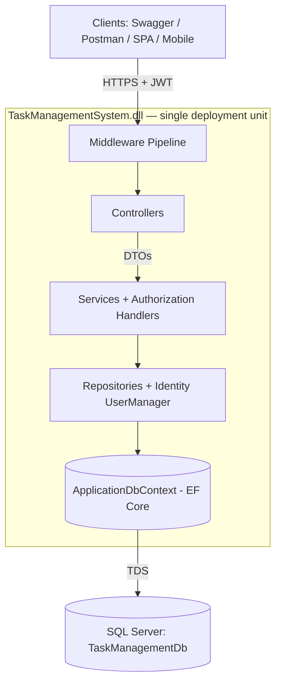
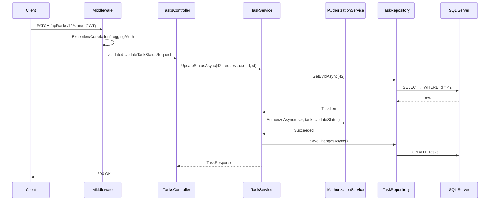
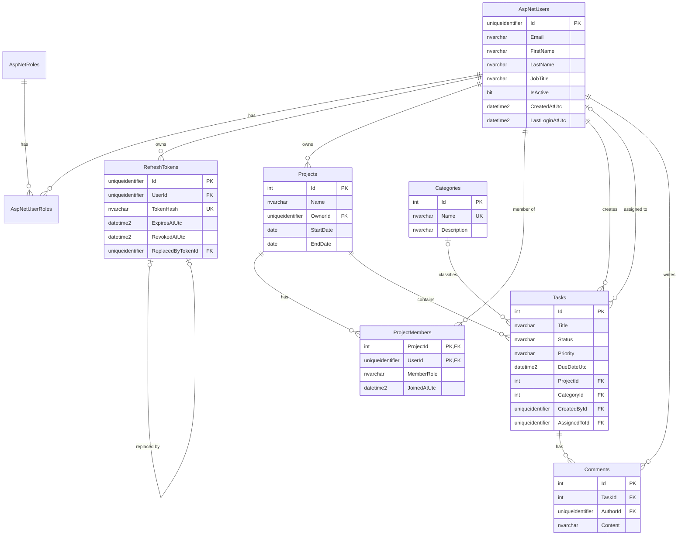

# Phase 1 — Requirements, Architecture & Database Design

> **Project:** Task Management System — ASP.NET Core **Monolithic** Architecture
> **Repository:** `01-MonolithicArchitecture-TaskManagementSystem`
> **Phase status:** ✅ Approved (2026-11-23) — all 8 decisions approved
> **Language note:** Phase 1 was written in Hinglish. From Phase 2 onward, all communication and docs are in English (user decision, 2026-11-23).

---

## Table of Contents
0. [Environment Check](#0-environment-check)
1. [Monolithic Architecture kya hai?](#1-monolithic-architecture-kya-hai)
2. [High-Level Architecture Diagram](#2-high-level-architecture-diagram)
3. [HTTP Request Flow](#3-http-request-flow)
4. [Middleware Execution Order](#4-middleware-execution-order)
5. [Deployment Diagram](#5-deployment-diagram)
6. [Advantages vs Disadvantages](#6-advantages-vs-disadvantages)
7. [Modules & Permission Matrix](#7-modules--permission-matrix)
8. [Database Design](#8-database-design)
9. [Folder Structure](#9-folder-structure)
10. [Decisions (Pending Approval)](#10-decisions-approved)
11. [Common Mistakes](#11-common-mistakes)
12. [Interview Questions](#12-interview-questions)
13. [Practical Exercises](#13-practical-exercises)

---

## 0. Environment Check

Checked on 2026-11-23 on the development machine:

| Item | Found | Note |
|---|---|---|
| .NET SDKs | 8.0.421, 11.0.100 | ⚠️ **.NET 10 SDK installed nahi hai** (see Decision #3) |
| .NET Runtime | 10.0.15 installed | App run ho sakti hai |
| SQL Server | Default instance `MSSQLSERVER` running + LocalDB | ✅ |
| Git | 2.53 | ✅ |

---

## 1. Monolithic Architecture kya hai?

### Concept
**Monolith** = "ek hi pathar se bana hua". Software mein iska matlab: poori application — Authentication, Projects, Tasks, Comments, Dashboard — **ek hi codebase**, **ek hi process**, **ek hi deployment unit**, aur usually **ek hi database**.

**Analogy:** Ek restaurant jiska ek hi kitchen hai jahan starters, main course aur desserts sab bante hain. Ek kitchen, ek staff, ek gas connection. Chef ek doosre ko awaaz deke baat kar lete hain (direct method call). Microservices = har dish ka alag restaurant jo delivery boy (network) se baat karte hain.

### WHY — kyun chahiye?
- Sabse **simple** architecture jisse production-grade app ban sakti hai.
- Modules ek doosre se **direct in-process method call** se baat karte hain — no network, no serialization, no distributed failures.
- Ek database → **ACID transactions aasaan** (task delete → uske comments bhi same transaction mein delete).
- Debugging aasaan: ek process, ek log stream, ek breakpoint.

### HOW — kaise kaam karta hai?
Andar se code ko **layers** mein organise karte hain (Controllers → Services → Repositories → DbContext). Ye sirf **folders/namespaces** hain, alag deployables nahi. Sab ek hi `.dll` mein compile hota hai.

> ⚠️ **Important distinction — yeh Clean Architecture NAHI hai.**
> Is project mein Controllers/Services/Repositories hain = **Layered (N-Tier) Monolith**.
> - **Clean Architecture:** Domain sabse andar, kisi par depend nahi karta; Infrastructure Domain par depend karta hai (Dependency Inversion, multiple projects).
> - **Hamara project:** Dependency **upar se neeche** — Controller → Service → Repository → EF Core. Entities = EF Core entities. Sab **ek hi project** mein.

---

## 2. High-Level Architecture Diagram

```
                         ┌──────────────────────────────────────┐
                         │              CLIENTS                 │
                         │  Swagger UI │ Postman │ SPA │ Mobile │
                         └──────────────────┬───────────────────┘
                                            │ HTTPS (JSON + JWT Bearer)
                                            ▼
╔═══════════════════════════════════════════════════════════════════════════╗
║          TaskManagementSystem.dll  — ONE PROCESS / ONE DEPLOYMENT          ║
║                                                                           ║
║  ┌─────────────────────── MIDDLEWARE PIPELINE ──────────────────────────┐ ║
║  │ ExceptionHandling → CorrelationId → SerilogRequestLogging → HTTPS →  │ ║
║  │ Routing → CORS → Authentication(JWT) → Authorization → Endpoints     │ ║
║  └──────────────────────────────────┬───────────────────────────────────┘ ║
║                                     ▼                                     ║
║  ┌──────────────────────── PRESENTATION LAYER ──────────────────────────┐ ║
║  │ AuthController  UsersController  CategoriesController                │ ║
║  │ ProjectsController  TasksController  CommentsController              │ ║
║  │ DashboardController        + ValidationFilter (FluentValidation)     │ ║
║  └──────────────────────────────────┬───────────────────────────────────┘ ║
║                         DTOs in/out │  (Entities never leave the API)     ║
║  ┌──────────────────────── BUSINESS (SERVICE) LAYER ────────────────────┐ ║
║  │ AuthService  TokenService  UserService  CategoryService              │ ║
║  │ ProjectService  TaskService  CommentService  DashboardService        │ ║
║  │ IAuthorizationService ← ProjectAuthorizationHandler,                 │ ║
║  │                         TaskAuthorizationHandler, CommentAuthHandler │ ║
║  └──────────────────────────────────┬───────────────────────────────────┘ ║
║                                     ▼                                     ║
║  ┌──────────────────────── DATA ACCESS LAYER ───────────────────────────┐ ║
║  │ CategoryRepository  ProjectRepository  TaskRepository                │ ║
║  │ CommentRepository   RefreshTokenRepository                           │ ║
║  │ UserManager/RoleManager (ASP.NET Core Identity)                      │ ║
║  │                 ▼                                                    │ ║
║  │        ApplicationDbContext (EF Core, IdentityDbContext)             │ ║
║  └──────────────────────────────────┬───────────────────────────────────┘ ║
║   Cross-cutting: Serilog │ Options(JwtSettings) │ IEmailSender │ Clock    ║
╚═════════════════════════════════════╪═════════════════════════════════════╝
                                      │ ADO.NET / TDS
                                      ▼
                       ┌──────────────────────────────┐
                       │ SQL Server: TaskManagementDb │
                       │ (ONE shared database)        │
                       └──────────────────────────────┘
```

Mermaid version (GitHub / VS Code preview mein render hota hai):



### Components aapas mein kaise baat karte hain?

| From → To | Mechanism | Example |
|---|---|---|
| Client → API | HTTP/JSON | `POST /api/tasks` |
| Controller → Service | **In-process method call** via constructor-injected interface | `await _taskService.CreateAsync(dto, userId, ct)` |
| Service → Service | In-process call (sparingly) | `TaskService` uses `IProjectRepository` to verify membership |
| Service → Repository | Interface call | `_taskRepository.GetByIdAsync(id, ct)` |
| Repository → DB | EF Core LINQ → SQL | `_db.Tasks.Where(...)` |
| Errors → Client | Exception → global middleware → `ProblemDetails` | `NotFoundException` → 404 |

**Key point:** Monolith mein **sirf ek network boundary** hai (client ↔ API). Andar sab memory mein hota hai.

---

## 3. HTTP Request Flow

**Example:** User task #42 ka status change karta hai — `PATCH /api/tasks/42/status` body `{ "status": "InProgress" }`

```
 Client
   │  PATCH /api/tasks/42/status   Authorization: Bearer eyJ...
   ▼
 ① ExceptionHandlingMiddleware   try { await next() } catch → ProblemDetails
 ② CorrelationIdMiddleware        reads/creates X-Correlation-ID, pushes to log context
 ③ SerilogRequestLogging          starts timer
 ④ HttpsRedirection               http → https
 ⑤ Routing                        matches TasksController.UpdateStatus(int id, ...)
 ⑥ CORS                           checks Origin (browser clients)
 ⑦ Authentication                 validates JWT signature/expiry/issuer → HttpContext.User
 ⑧ Authorization                  [Authorize] → authenticated? (401 if not)
 ⑨ Model binding + ValidationFilter  JSON → UpdateTaskStatusRequest → FluentValidation (400)
   ▼
 ⑩ TasksController.UpdateStatus
       → _taskService.UpdateStatusAsync(42, request, currentUserId, ct)
   ▼
 ⑪ TaskService
       task = await _taskRepository.GetByIdAsync(42)          → null? NotFoundException (404)
       await _authorizationService.AuthorizeAsync(User, task, TaskOperations.UpdateStatus)
                                                               → fail? ForbiddenException (403)
       business rule: valid transition Todo→InProgress?        → no? ConflictException (409)
       task.Status = InProgress; task.UpdatedAtUtc = now
       await _taskRepository.SaveChangesAsync(ct)
       return task.ToResponse()   (Entity → DTO mapping)
   ▼
 ⑫ Controller returns 200 OK + TaskResponse JSON
   ▼
 ③ Serilog logs: "HTTP PATCH /api/tasks/42/status responded 200 in 35 ms" (+ CorrelationId, UserId)
   ▼
 Client receives response (+ X-Correlation-ID header)
```



---

## 4. Middleware Execution Order

Russian-doll model — request andar jaati hai, response ulte order mein bahar aata hai:

```
Request ──►┌─ExceptionHandling──────────────────────────────────────────┐
           │ ┌─CorrelationId───────────────────────────────────────────┐│
           │ │ ┌─SerilogRequestLogging─────────────────────────────────┐││
           │ │ │ ┌─HttpsRedirection──────────────────────────────────┐│││
           │ │ │ │ ┌─Routing───────────────────────────────────────┐ ││││
           │ │ │ │ │ ┌─CORS──────────────────────────────────────┐ │ ││││
           │ │ │ │ │ │ ┌─Authentication─────────────────────────┐│ │ ││││
           │ │ │ │ │ │ │ ┌─Authorization────────────────────────┐││ │ ││││
           │ │ │ │ │ │ │ │      Endpoint (Controller action)    │││ │ ││││
           │ │ │ │ │ │ │ └──────────────────────────────────────┘││ │ ││││
Response ◄─┘ (response travels back OUT through the same layers in reverse)
```

**Rules:**
- Exception handler **sabse bahar** — taaki har layer ki exception pakad sake.
- `UseAuthentication` **pehle**, `UseAuthorization` **baad mein** — pehle "aap kaun ho?", phir "aap kya kar sakte ho?".
- `UseCors` → `UseRouting` ke baad aur auth se pehle.
- Swagger sirf **Development** environment mein enabled.

---

## 5. Deployment Diagram

```
 Developer ──git push──► GitHub ──(CI: build + test)──► dotnet publish -c Release
                                                            │
                                                            ▼
                                              ONE artifact: /publish folder
                                              (TaskManagementSystem.dll + deps)
                                                            │
              ┌─────────────────────────────────────────────┼──────────────┐
              ▼                       ▼                     ▼              ▼
       IIS (Windows)          Kestrel + Nginx         Docker image   Azure App Service
              └───────────────────────┬─────────────────────┘
                                      ▼
                         SQL Server (one database)
```

- **Scaling:** Poori app ki N copies Load Balancer ke peeche (horizontal scaling). JWT stateless hai → kisi bhi copy par request jaaye, kaam karega. Refresh tokens DB mein (shared).
- Ek line change → **poori app** rebuild + retest + redeploy. Yahi monolith ki pehchaan hai.

---

## 6. Advantages vs Disadvantages

| ✅ Advantages | ❌ Disadvantages |
|---|---|
| Develop, run, debug karna aasaan | Codebase badhne par "Big Ball of Mud" ka khatra |
| Ek deployment, ek pipeline | Chhote change ke liye bhi poora redeploy |
| ACID transactions aasaan (ek DB) | Poori app ek saath scale hoti hai — sirf Tasks module ko alag scale nahi kar sakte |
| In-process calls fast — no network latency | Technology lock-in — poori app ek stack par |
| End-to-end testing aasaan | Ek memory leak/crash poori app gira deta hai |
| Chhoti team ke liye kam operational cost | Badi teams mein merge conflicts, coordination overhead |

**Kab use karein:** Naya product/MVP, chhoti–medium team (~1–10 devs), domain abhi clear nahi, moderate scale, chhoti ops team. *Zyada tar successful systems monolith se hi shuru hue.*

**Kab avoid karein:** Kai independent teams jinhe alag release cadence chahiye; modules ki scaling needs bahut alag; alag tech stacks chahiye. Tab pehle **Modular Monolith**, phir zaroorat ho to **Microservices** (future repositories).

---

## 7. Modules & Permission Matrix

### Modules

| Module | Responsibility |
|---|---|
| **Auth** | Register, Login, Logout, Refresh (rotation), Email verify, Forgot/Reset/Change password |
| **Users** | Own profile get/update; Admin: list users, change roles, activate/deactivate |
| **Categories** | Global task categories (e.g. Bug, Feature, Research) |
| **Projects** | Projects + members (team) |
| **Tasks** | CRUD, assign, status workflow, priority, due date, search/filter/sort/paging |
| **Comments** | Task par discussion |
| **Dashboard** | Counts by status/priority, overdue, due this week, per-project stats (caller ke scope ke hisaab se) |

### Authorization Matrix (server-side enforced)

| Action | Admin | Manager | User |
|---|---|---|---|
| Category: read | ✅ | ✅ | ✅ |
| Category: create/update/delete | ✅ | ❌ | ❌ |
| Project: create | ✅ | ✅ (becomes Owner) | ❌ |
| Project: read | all | owned + member | member only |
| Project: update/delete, manage members | all | **owned only** (resource-based) | ❌ |
| Task: create | any project | own projects | projects where member |
| Task: update/delete | all | tasks in own projects | tasks **they created** |
| Task: assign | all | own projects (assignee must be project member) | ❌ |
| Task: update status | all | own projects | creator **or assignee** |
| Comment: add/read | all | if can read task | if can read task |
| Comment: edit | author only | author only | author only |
| Comment: delete | any | author + own project's tasks | author only |
| Users: manage | ✅ | ❌ | ❌ |
| Dashboard | global | own projects | own/assigned tasks |

### Chaaron authorization types kahan use honge

| Type | Example in this project |
|---|---|
| **Role-based** | `[Authorize(Roles = "Admin")]` on admin user management |
| **Claims-based** | `email_verified = true` claim in JWT — unverified users sirf read kar sakte hain |
| **Policy-based** | `Policies.CanManageCategories`, `Policies.CanCreateProjects`, `Policies.EmailVerified` |
| **Resource/Ownership-based** | `ProjectAuthorizationHandler`, `TaskAuthorizationHandler`, `CommentAuthorizationHandler` via `IAuthorizationService.AuthorizeAsync(user, resource, operation)` |

### Task Status Workflow (business rule)

```
 Todo ──► InProgress ──► InReview ──► Done
  ▲          │  ▲            │         │ (reopen: Manager/Admin only → InProgress)
  └──────────┘  └────────────┘         │
 Any non-Done ──► Cancelled            CompletedAtUtc set when → Done
```

- **Status:** `Todo, InProgress, InReview, Done, Cancelled`
- **Priority:** `Low, Medium, High, Critical`
- Invalid transition → **409 Conflict**

---

## 8. Database Design

### ER Diagram (ASCII)

```
                         ┌──────────────────┐        ┌───────────────────┐
                         │   AspNetRoles    │        │  AspNetUserRoles  │
                         │ PK Id (Guid)     │1──────*│ PK,FK UserId      │
                         │    Name          │        │ PK,FK RoleId      │
                         └──────────────────┘        └─────────┬─────────┘
                                                               │*
                                                               │1
┌─────────────────────┐ 1        *  ┌──────────────────────────┴──────────────┐
│   RefreshTokens     │◄────────────┤           AspNetUsers (ApplicationUser) │
│ PK Id (Guid)        │             │ PK Id (Guid)  Email  UserName           │
│ FK UserId           │             │ FirstName LastName JobTitle IsActive    │
│ TokenHash (UQ)      │             │ CreatedAtUtc LastLoginAtUtc             │
│ ExpiresAtUtc        │             └──┬──────────┬──────────┬─────────┬──────┘
│ RevokedAtUtc        │                │1         │1         │1        │1
│ FK ReplacedByTokenId├──┐ 1:1 self    │ owns     │ member   │creates/ │ writes
└─────────────────────┘◄─┘ (rotation)  │*         │*         │assigned │*
                                       ▼          ▼          │*        ▼
┌──────────────────┐            ┌────────────┐ ┌───────────────┐ │  ┌──────────────┐
│   Categories     │            │  Projects  │ │ProjectMembers │ │  │  Comments    │
│ PK Id (int)      │            │ PK Id (int)│1│PK,FK ProjectId│ │  │ PK Id (int)  │
│ Name (UQ)        │            │ Name       ├*│PK,FK UserId   │ │  │ FK TaskId    │
│ Description      │            │ FK OwnerId │ │ MemberRole    │ │  │ FK AuthorId  │
└────────┬─────────┘            └─────┬──────┘ └───────────────┘ │  │ Content      │
         │1                           │1                          │  └──────▲───────┘
         │ (optional)                 │                           │         │*
         │*                           │*                          │         │1
         │              ┌─────────────▼──────────────┐            │         │
         └─────────────►│      Tasks (TaskItem)      │◄───────────┘         │
                        │ PK Id (int)   Title        ├──────────────────────┘
                        │ Status Priority DueDateUtc │
                        │ FK ProjectId  FK CategoryId│
                        │ FK CreatedById FK AssignedToId
                        └────────────────────────────┘
```

### ER Diagram (Mermaid)



### Tables & Columns

| Table | Columns |
|---|---|
| **AspNetUsers** | `Id uniqueidentifier PK`, Identity columns (Email, PasswordHash, SecurityStamp, EmailConfirmed…), `FirstName nvarchar(50)`, `LastName nvarchar(50)`, `JobTitle nvarchar(100) NULL`, `IsActive bit`, `CreatedAtUtc`, `UpdatedAtUtc NULL`, `LastLoginAtUtc NULL` |
| **AspNetRoles / AspNetUserRoles** | Identity standard (`Guid` keys). Identity saath mein UserClaims, RoleClaims, UserLogins, UserTokens tables bhi banata hai |
| **RefreshTokens** | `Id uniqueidentifier PK`, `UserId FK`, `TokenHash nvarchar(128) UQ` (SHA-256 — raw token kabhi DB mein nahi), `ExpiresAtUtc`, `CreatedAtUtc`, `CreatedByIp nvarchar(45)`, `RevokedAtUtc NULL`, `RevokedByIp NULL`, `RevokedReason nvarchar(100) NULL`, `ReplacedByTokenId FK NULL` |
| **Categories** | `Id int IDENTITY PK`, `Name nvarchar(100) UQ`, `Description nvarchar(500) NULL`, `CreatedAtUtc`, `UpdatedAtUtc NULL` |
| **Projects** | `Id int PK`, `Name nvarchar(150)`, `Description nvarchar(2000) NULL`, `OwnerId FK`, `StartDate date NULL`, `EndDate date NULL`, `CreatedAtUtc`, `UpdatedAtUtc NULL` |
| **ProjectMembers** | `ProjectId + UserId` **composite PK**, `MemberRole nvarchar(20)` (`Owner/Member`), `JoinedAtUtc` |
| **Tasks** | `Id int PK`, `Title nvarchar(200)`, `Description nvarchar(4000) NULL`, `Status nvarchar(20)`, `Priority nvarchar(20)`, `DueDateUtc NULL`, `CompletedAtUtc NULL`, `ProjectId FK`, `CategoryId FK NULL`, `CreatedById FK`, `AssignedToId FK NULL`, `CreatedAtUtc`, `UpdatedAtUtc NULL` |
| **Comments** | `Id int PK`, `TaskId FK`, `AuthorId FK`, `Content nvarchar(2000)`, `CreatedAtUtc`, `UpdatedAtUtc NULL` |

### Relationships

| Type | Example | Explanation |
|---|---|---|
| **One-to-One** | `RefreshToken.ReplacedByTokenId → RefreshToken` | Rotation mein har token ko **max ek** naya token replace karta hai — self-referencing 1:1, unique filtered index se enforce. (Profile fields `AspNetUsers` mein hi hain — alag `UserProfiles` table banana overengineering hota.) |
| **One-to-Many** | User → RefreshTokens, Project → Tasks, Task → Comments, Category → Tasks, User → Tasks (Created/Assigned) | Parent ka PK → child mein FK |
| **Many-to-Many** | Users ↔ Projects via **ProjectMembers**; Users ↔ Roles via **AspNetUserRoles** | Explicit join entity kyunki extra data hai (`MemberRole`, `JoinedAtUtc`) |

### Cascade Delete Behavior

| Relationship | On Delete | Why |
|---|---|---|
| Project → Tasks | **Cascade** | Project gaya to tasks ka matlab nahi |
| Task → Comments | **Cascade** | Comments task ka hissa hain |
| Project → ProjectMembers | **Cascade** | Membership project ke saath khatam |
| Category → Tasks | **SetNull** | Category hatne se tasks nahi hatne chahiye |
| User → RefreshTokens | **Cascade** | Tokens user ke bina bekaar |
| User → Projects / Tasks / Comments / ProjectMembers | **Restrict** | Users ko **hard delete nahi**, **deactivate** (`IsActive = false`) karte hain — history (kisne banaya, kisne comment kiya) bachi rehti hai |
| RefreshToken → RefreshToken (self) | **NoAction** | SQL Server self-referencing cascade allow nahi karta |

> 💡 **SQL Server trap:** `Introducing FOREIGN KEY constraint ... may cause cycles or multiple cascade paths` — jab ek hi parent table se child tak do cascade raaste hon. User-related FKs ko `Restrict` rakh kar hum isse bachte hain.

### Indexes & Constraints

| Index / Constraint | Purpose |
|---|---|
| `UQ Categories(Name)` | Duplicate category → **409 Conflict** |
| `UQ Projects(OwnerId, Name)` | Ek owner ke do projects ka same naam nahi |
| `UQ RefreshTokens(TokenHash)`, `IX RefreshTokens(UserId)` | Fast token lookup, "revoke all for user" |
| `IX Tasks(ProjectId, Status)`, `IX Tasks(AssignedToId, Status)`, `IX Tasks(DueDateUtc)`, `IX Tasks(CreatedById)`, `IX Tasks(CategoryId)` | Filtering + dashboard queries |
| `IX Comments(TaskId, CreatedAtUtc)` | Task ke comments time order mein |
| `CK Projects: EndDate >= StartDate` | DB-level safety net |
| `CK Tasks: Status IN (...)`, `Priority IN (...)` | Enums strings ke roop mein stored |
| Required columns + `nvarchar(n)` lengths | Validators ke rules DB mein mirror (defense in depth) |

> Note: `Title LIKE '%term%'` search index use nahi kar sakta — Phase 12 mein explain hoga (Full-Text Search = exercise).

---

## 9. Folder Structure

```
01-MonolithicArchitecture-TaskManagementSystem/
├── TaskManagementSystem.slnx                ← solution (.NET 10 default format)
├── global.json                              ← pins the SDK version
├── .gitignore  .editorconfig  README.md
├── docs/                                    ← architecture notes, phase notes (this file)
├── src/
│   └── TaskManagementSystem/                ← THE monolith (one Web API project)
│       ├── Controllers/
│       ├── Models/
│       │   ├── Entities/
│       │   └── DTOs/
│       ├── Data/
│       ├── Migrations/
│       ├── Interfaces/
│       │   ├── Repositories/
│       │   └── Services/
│       ├── Repositories/
│       ├── Services/
│       ├── Validators/
│       ├── Middleware/
│       ├── Filters/
│       ├── Authorization/
│       ├── Exceptions/
│       ├── Extensions/
│       ├── Configuration/
│       ├── Mappings/
│       ├── Constants/
│       ├── Enums/
│       ├── Helpers/
│       ├── wwwroot/
│       ├── Properties/launchSettings.json
│       ├── appsettings.json / appsettings.Development.json
│       └── Program.cs
└── tests/
    ├── TaskManagementSystem.UnitTests/
    └── TaskManagementSystem.IntegrationTests/
```

### Har folder ki responsibility

| Folder / File | Responsibility |
|---|---|
| `Controllers/` | HTTP endpoints only — input bind karo, service call karo, status code return karo. **No business logic.** |
| `Models/Entities/` | EF Core persistence classes (`ApplicationUser`, `TaskItem`, `Project`, `ProjectMember`, `Category`, `Comment`, `RefreshToken`) |
| `Models/DTOs/` | Request/response contracts, grouped: `Auth/`, `Users/`, `Categories/`, `Projects/`, `Tasks/`, `Comments/`, `Dashboard/`, `Common/` (`PagedResult<T>`, query params) |
| `Data/` | `ApplicationDbContext`, `Configurations/` (`IEntityTypeConfiguration<T>` — Fluent API), `Seed/` (`DbSeeder` — roles + admin user) |
| `Migrations/` | EF Core generated migrations |
| `Interfaces/Repositories/` | `ITaskRepository`, `IProjectRepository`, `ICategoryRepository`, `ICommentRepository`, `IRefreshTokenRepository` |
| `Interfaces/Services/` | `IAuthService`, `ITokenService`, `IUserService`, `ITaskService`, `IEmailSender`, ... |
| `Repositories/` | EF Core query/persistence code — **no business rules** |
| `Services/` | Business logic, rules, authorization checks, Entity ↔ DTO mapping calls |
| `Validators/` | FluentValidation `AbstractValidator<TRequest>` classes |
| `Middleware/` | `ExceptionHandlingMiddleware`, `CorrelationIdMiddleware` |
| `Filters/` | `ValidationFilter` — action execute hone se pehle FluentValidation run karta hai |
| `Authorization/` | Policy name constants, Requirements, Handlers (resource-based), Operations |
| `Exceptions/` | `NotFoundException`, `ConflictException`, `ForbiddenException`, `BusinessRuleException` |
| `Extensions/` | `IServiceCollection` / `WebApplication` extension methods (Program.cs clean rehta hai), `ClaimsPrincipal` helpers |
| `Configuration/` | Strongly-typed Options: `JwtSettings`, `EmailSettings`, `CorsSettings` |
| `Mappings/` | Manual mapping extension methods (e.g. `TaskItem.ToResponse()`) |
| `Constants/` | `Roles`, custom claim types, policy names |
| `Enums/` | `TaskItemStatus`, `TaskPriority`, `ProjectMemberRole` |
| `Helpers/` | `TokenHasher` (SHA-256), small pure utilities |
| `wwwroot/` | Static files (minimal) |
| `appsettings*.json` | Non-secret config. **Secrets → User Secrets / environment variables** |
| `Program.cs` | Composition root — DI registration + middleware pipeline |
| `tests/...UnitTests/` | `Services/`, `Validators/`, `Helpers/` — xUnit + Moq |
| `tests/...IntegrationTests/` | `CustomWebApplicationFactory`, `Auth/`, `Tasks/`, ... — real HTTP pipeline, test database |

> Original proposal mein 4 folders add kiye: **`Filters/`, `Exceptions/`, `Mappings/`, `docs/`** — inke bina exceptions/mapping/validation code `Helpers/` mein "dumping ground" ban jaata. `src/` + `tests/` = standard .NET convention.

### Design Rules (poore project mein)
1. **Controllers thin** — koi business logic nahi.
2. **Entities kabhi API se bahar nahi** — sirf DTOs.
3. Entity ka naam **`TaskItem`**, `Task` nahi (table `Tasks` hi rahegi) — `System.Threading.Tasks.Task` se clash bachane ke liye.
4. **Specific repositories**, generic `IRepository<T>` nahi. `DbContext` already Unit of Work hai — alag `UnitOfWork` class nahi.
5. **Manual mapping**, AutoMapper nahi (explicit, debuggable; AutoMapper ab commercial license).
6. **Services exceptions throw karti hain** → global middleware unhe `ProblemDetails` + sahi status code mein convert karta hai.
7. Sab kuch **async + `CancellationToken`**. Timestamps **UTC**, time `TimeProvider` se (tests mein time control).

---

## 10. Decisions (Approved)

| # | Decision | Recommendation | Status |
|---|---|---|---|
| 1 | Teaching language | Changed by user: **English only** from Phase 2 | ✅ Approved |
| 2 | Repo location | `...\MonolithicArchitecture\01-MonolithicArchitecture-TaskManagementSystem\` as git repo root | ✅ Approved |
| 3 | .NET 10 SDK missing | Install .NET 10 SDK (`winget install Microsoft.DotNet.SDK.10`) + pin in `global.json`. Alternative: SDK 11 targeting `net10.0` | ✅ Approved |
| 4 | Dev email sending | `IEmailSender`; Development mein emails gitignored `emails/` folder mein `.html` files — tokens **kabhi logs mein nahi**. SMTP implementation config se switch | ✅ Approved |
| 5 | Integration test DB | Alag database `TaskManagementDb_IntegrationTests` (SQL Server/LocalDB), har test run par recreate. Testcontainers = baad mein exercise | ✅ Approved |
| 6 | Phase tweak | Basic global exception middleware + `Exceptions/` **Phase 4** mein; Phase 11 mein complete (Serilog, correlation, full ProblemDetails). Validators har module ke saath; global `ValidationFilter` Phase 11 mein finalize | ✅ Approved |
| 7 | Swagger on .NET 10 | Built-in `Microsoft.AspNetCore.OpenApi` (document) + `Swashbuckle.AspNetCore.SwaggerUI` (UI, JWT Authorize button) | ✅ Approved |
| 8 | Keys | Identity tables → `Guid`; domain tables → `int IDENTITY` (safe kyunki har request par resource-based authorization) | ✅ Approved |

---

## 11. Common Mistakes

- Monolith = "bina structure ka code" samajhna ❌ — andar ka organisation utna hi zaroori hai.
- Controller mein seedha `DbContext` + business logic likhna.
- Entities seedha return karna → `PasswordHash` leak, circular reference JSON errors, over-posting attacks.
- Sirf `[Authorize(Roles=...)]` par bharosa — "Manager sirf **apna** project update kare" role se enforce nahi hota; resource-based authorization chahiye.
- Har relationship par Cascade → data loss + SQL Server multiple-cascade-path errors.
- Refresh tokens plain text mein store karna.

---

## 12. Interview Questions

1. Monolithic vs Modular Monolith vs Microservices — difference?
2. Layered monolith aur Clean Architecture mein dependency direction ka farq?
3. Monolith ko horizontally scale kaise karenge? Stateless JWT kaise madad karta hai?
4. "Monolith first" approach kyun recommend kiya jaata hai?
5. Many-to-many ke liye explicit join entity kab banani chahiye?
6. SQL Server "multiple cascade paths" error kyun aata hai aur kaise solve karte hain?
7. Users ko hard delete ki jagah soft deactivate kyun?
8. Middleware order mein `UseAuthentication` → `UseAuthorization` kyun?

---

## 13. Practical Exercises

1. ER diagram khud kaagaz par redraw karein aur har FK ke aage uska delete behavior likhein.
2. "Manager ne aise User ko task assign kiya jo project member nahi hai" — iska request flow (Section 3 jaisa) khud likhein. Kaunsa status code aana chahiye?
3. Agar kal "Tasks module" ko alag scale karna pade, to is monolith mein kaunse couplings (shared tables, direct calls) mushkil banayenge?
